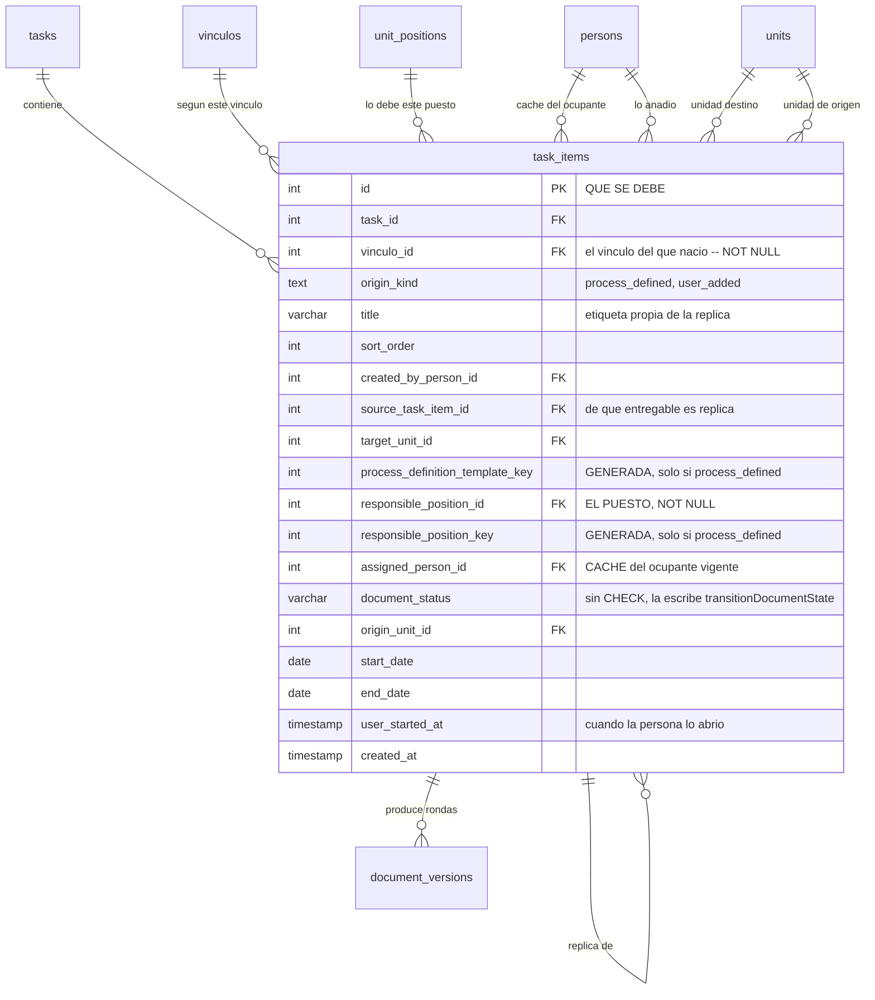

Esta es la tabla central del sistema (`task_items`), y también la que más cambió en agosto de 2026.
Un **entregable concreto** responde a la pregunta *«qué documento se debe»*, y su identidad son tres
cosas juntas: **qué tarea, qué vínculo de plantilla, y qué puesto lo produce**.

Esa tercera pata —el puesto responsable— es obligatoria (`responsible_position_id INT NOT NULL`) y es
el ancla de todo lo demás. Es lo durable: un puesto sobrevive a quien lo ocupa, y es el punto por el
que enganchan los cuatro caminos de relevo. **No puede haber un entregable sin puesto responsable**;
si al disparar el proceso no hay a quién dirigirse, el entregable sencillamente no se crea.

:::note[El «Para:» no existe]

`target_position_id` y `target_person_id` vivieron aquí hasta el 2026-08-23. Eran el destinatario —a
quién iba **dirigido** el documento— y no hay que confundirlos con quien lo **produce**: son receptor
y emisor, no dos nombres del mismo dato.

Se retiraron porque el destinatario es derivable: quien firma al final es a quien va dirigido, y un
envío **exige** su flujo, así que ese dato siempre está. Guardarlo aparte era mantener a mano un
resumen del flujo que además podía mentir: el cliente lo calculaba como «el primer firmante», así que
con dos pasos nombraba al aprobador intermedio.

:::

## De dónde puede venir un entregable

Un entregable nace de una de dos formas, y lo dice `origin_kind`, que tiene `CHECK` con dos valores:

- **`process_defined`** — lo creó el disparo, a partir de un vínculo en modo `single`. Es el valor por
  defecto.
- **`user_added`** — lo añadió una persona: una réplica en modo `replicated`, o una tarea suelta en
  modo `routed`. Guarda quién lo añadió (`created_by_person_id`) y, si es una copia, de cuál desciende
  (`source_task_item_id`).

## Tres campos que hay que leer con cuidado

### `assigned_person_id` es una caché, no el dato

Dice quién es hoy el responsable, pero **su único escritor es el trigger
`trg_task_item_tenures_sync`**, que la deriva de la tenencia abierta (la página siguiente). En el
editor genérico es de solo lectura: para cambiar de responsable existe el traspaso, no un `UPDATE`.

No se retiró la columna porque tiene decenas de referencias y está en los dos caminos calientes —el
motor de acceso y el panel—, donde metería un `JOIN`. Lo que se retiró es la posibilidad de que se
desincronice: antes la escribían cuatro sitios.

### `document_status` es el estado que sí avanza

`VARCHAR(30) NOT NULL DEFAULT 'Inicial'`. Se llama así y no `status` **a propósito**:
`task_items.status` vivió aquí hasta el 2026-08-23 y se retiró por no tener escritores —se quedaba en
`'pendiente'` para siempre mientras siete sitios la leían con dos vocabularios que no compartían ni
un literal—. Reutilizar el nombre invitaría a confundirlas.

Su lista de valores válidos **vive en el código, no en la base**: no hay `CHECK`. La escribe
`transitionDocumentState()`, derivándola del estado de la versión del documento.

### Las columnas `_key` son generadas, y sostienen una regla de negocio

`process_definition_template_key` y `responsible_position_key` **no son copias de seguridad**: son
columnas `GENERATED ALWAYS AS … STORED` que valen el identificador original *solo si*
`origin_kind = 'process_defined'`, y `NULL` si lo añadió una persona.

Existen para que `uq_task_items_defined_target (task_id, process_definition_template_key,
responsible_position_key)` se aplique **únicamente a lo que genera el proceso**. En PostgreSQL los
`NULL` no chocan entre sí en un índice único, y de ahí sale el efecto, que es una regla de negocio
real:

> **El disparo no puede crear dos veces el mismo entregable para el mismo puesto, pero una persona sí
> puede crear tantas réplicas como necesite.**

## De qué línea y de qué proceso es un entregable, y por qué no puede cambiar

Un entregable no lleva escritos su línea ni su proceso: llega a ellos por cuatro claves, las cuatro
obligatorias.

```
task_items.task_id  →  tasks.process_definition_id  →  process_definition_versions.linea_id
                    →  lineas.process_id
```

Desde el 2026-11-18 **ninguna de las cuatro se puede cambiar una vez escrita**. Lo impide la base,
con un disparador por eslabón (`trg_task_items_tarea_inmutable`,
`trg_tasks_configuracion_inmutable`, `trg_configuracion_linea_inmutable`,
`trg_lineas_proceso_inmutable`), así que vale para todos los caminos, incluido el editor genérico de
`/admin`. El intento contesta *«No se puede cambiar tasks.process_definition_id una vez
escrito…»*.

Importa porque de esa cadena depende **a qué proceso pertenece cada documento**. Antes, mover una
configuración de línea reclasificaba de golpe todos los entregables de todas sus tareas, hacia atrás
y sin dejar rastro. Ningún código de la aplicación lo hacía —el disparo y la tarea suelta sólo
escriben esas claves al crear—, pero nada lo impedía.

Tres cosas que conviene saber:

- **No se copió la línea al entregable.** Sería el mismo dato dicho dos veces, y el modelo ya retiró
  una copia así (`process_definition_versions.process_id`, que duplicaba `lineas.process_id`). La
  línea se sigue leyendo por la cadena; lo que cambió es que la cadena ya no se mueve.
- **Reescribir el mismo valor sí pasa.** El editor genérico manda la fila entera al guardar, y
  rechazarle un eslabón que no ha tocado bloquearía cualquier otra edición.
- **Una línea no se muda de proceso: la sucede otra.** La línea ya tiene vigencia propia
  (`effective_from`, `effective_to`) y sucesión (`linea_anterior_id`), y el proceso es parte de su
  identidad —sus dos índices únicos empiezan por `process_id`—. Si pasa a otro proceso es una línea
  nueva que apunta a la anterior, y los documentos de la antigua siguen siendo de la antigua.
- **Lo que una reorganización mueve es el proceso dentro de su árbol**, no la línea. Que ese
  movimiento guarde su historia está decidido y **sin construir**, igual que el control del borrado.

:::caution[Esta sección decía lo contrario durante unas horas]
La primera versión afirmaba que `lineas.process_id` era «el único eslabón que tiene que poder
cambiar». Era falso, y se corrigió el mismo 2026-11-18 al mirar la tabla de líneas: la vigencia y la
sucesión que hacían innecesario mudarla ya estaban ahí.
:::

## Qué cuelga de aquí

Desde el 2026-08-23 **`document_versions` cuelga directamente de `task_items`**
(`document_versions.task_item_id`, con `ON DELETE CASCADE`). En medio había una tabla `documents`, en
relación 1:1 estricta con el entregable —un solo `INSERT` en todo el backend y siempre con
`task_item_id`— y **sin una sola columna propia**: `owner_person_id` era copia del responsable,
`title` se escribía y nadie la leía, `comments_thread_ref` era un fósil, `status` era derivada, y
`origin_unit_id` una caché. Las dos últimas se mudaron aquí y las tres primeras se retiraron.

También cuelgan de aquí las tenencias (`task_item_tenures`, `ON DELETE CASCADE`), que son la página
siguiente.

:::note[Qué edición de plantilla se usa: aquí no se guarda]

`task_items` tuvo una columna `edicion_id` hasta el 2026-10-04. Era una **copia** de
`vinculos.edicion_id`, o sea del vínculo que la columna de al lado ya
apunta: coincidían siempre porque solo existía una versión de cada plantilla, y nada obligaba a que
siguieran coincidiendo. Se retiró, y `vinculo_id` pasó a ser **obligatoria**.

La creencia que la sostenía —«un entregable ad-hoc no tiene vínculo»— era falsa, y hubo que
corregirla cuatro veces: las tareas ad-hoc cuelgan del **Proceso por defecto**
(`GENERAL_PROCESS_SLUG = "default"`), y sus dos caminos de alta toman el vínculo de la configuración
activa de ese proceso. Solo dos ficheros del backend insertan en esta tabla, y los dos lo ponen.

Quien necesite la edición la alcanza por el vínculo, con el `JOIN` que casi todos sus lectores ya
hacían para llegar al nombre del entregable.

:::


