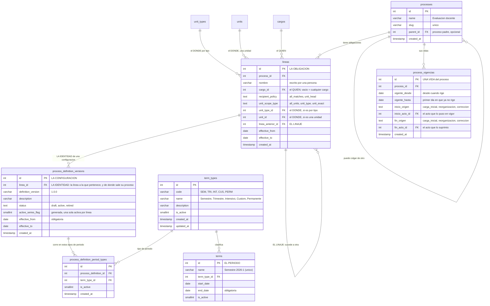

Un **proceso** (`processes`) es apenas un nombre: «Evaluación docente», «Informe semestral». No
contiene reglas. Puede colgar de otro proceso —`parent_id` es autorreferencial—, formando un árbol.

Las reglas viven un piso más abajo, en la **configuración** (`process_definition_versions`). Y aquí
está la primera decisión de diseño importante: **una configuración no se edita, se versiona**. Cuando
cambian las reglas nace una versión nueva y la anterior se retira. La retirada no se borra: se queda
como registro de cómo se hacían las cosas entonces.

Cada configuración tiene tres estados, cerrados por un `CHECK`: `draft` mientras se prepara, `active`
cuando rige, y `retired` cuando la sustituyó otra. **Solo puede haber una activa por línea**, y de
nuevo es la base quien lo garantiza: la columna generada `active_series_flag` más el índice único
`uq_process_definition_one_active_linea` sobre `(linea_id, active_series_flag)` lo hacen imposible.

:::caution[Dónde se impone cada mitad de «no se edita, se versiona»]

Son dos mecanismos distintos, y conviene no confundirlos.

**La base** impone la unicidad de la activa (índice), y **un trigger**
(`trg_process_definition_versions_before_update`) impide pasar a `active` una configuración que no
tenga al menos una regla de alcance activa *y* un tipo de periodo activo — con mensaje de error en
español.

**El servicio** impone la inmutabilidad: `ensureDraftDefinitionContext` rechaza tocar las reglas, los
vínculos a plantilla o los tipos de periodo de una configuración que no esté en `draft`. Eso no está
en el esquema, así que una escritura directa a la base sí podría saltárselo.

:::

## Las dos coordenadas de una configuración

Una configuración no se identifica solo por su proceso. Lleva dos coordenadas más, y cada una
responde a una pregunta distinta:

- **La línea** (`lineas`) — **de quién es la obligación y dónde vive**, los dos ejes juntos. Es la
  identidad de la configuración.
- **La vigencia** (`effective_from`, obligatoria, y `effective_to`, opcional) — desde cuándo rige y
  hasta cuándo.

Junto a ellas va `definition_version`, la etiqueta de versión de las reglas (`1.0.0` en la que siembra
el arranque). **La pareja `(línea, versión)` es única.**

Y **esa pareja es también su nombre**: la configuración no tiene columna de nombre. Se compone al
leerla —«*Informe de Gestión Docente · 1.0.0*»— con una función del esquema,
`nombre_configuracion(nombre de la línea, versión)`, igual que su proceso se lee de la línea.

:::note[Aquí hubo una columna `name`, y era una copia caducada]

Hasta el **2026-10-14** el nombre era una columna, escrita con el valor de `lineas.nombre`. Fallaba
por los dos lados:

- **No distinguía.** Dos configuraciones de la misma línea tenían el **mismo** nombre. En la base
  sembrada, la `1.0.0` y la `1.1.0` de la línea del «Proceso por defecto» decían las dos *«Proceso
  por defecto»*: la columna que servía para nombrar no servía para identificar.
- **Se quedaba atrás.** Renombrar la línea no actualizaba sus configuraciones. Había una rutina de
  resincronización, pero colgaba del único disparador que ya no podía cambiar nada —renombrar el
  **proceso**, cuando el nombre pasó a ser el de la línea— y **no existía ningún gancho de
  `lineas`**. Se provocó en el navegador antes de quitarla: las dos configuraciones se quedaron con
  el nombre viejo.

Con la columna se fueron **tres** sitios que la reparaban (la rutina, el gancho del renombrado y una
reescritura en cada guardado), y la ambigüedad desapareció sola al derivar la identidad entera. El
detalle medido está en el frente 25 del plan.

:::

:::note[Aquí había una tercera coordenada, y era una copia]

Hasta el **2026-10-11** había una «variación»: una etiqueta de texto en la configuración, con valor
`general` por defecto, y la identidad era el trío *(proceso, variación, versión)*. Esa etiqueta era
**una copia** del `code` de la serie, arrastrada por un gancho del CRUD que **no era transaccional** —
y los dos índices únicos de la tabla estaban **sobre la copia**, no sobre el dato. Peor: el arranque
usaba dos constantes para una sola cosa, así que en una base recién sembrada **todas** las
configuraciones tenían la etiqueta distinta de su origen.

Hoy la identidad es la **línea**, que es una columna y un `id`. El detalle medido está en el frente
25 del plan.

:::

:::note[La LÍNEA sustituyó a la serie, y por qué]

El **2026-10-11** la tabla **`lineas`** ocupó el sitio de la serie y de la variación. No es un
sinónimo: una línea lleva **los dos ejes a la vez** —`cargo_id` (el quién) y el
alcance (el dónde: `unit_scope_type` con `all_units`, `unit_type` o `unit_exact`)— mientras la serie admite **uno
o el otro**, nunca los dos.

Y desde el **2026-10-15** lleva también `recipient_policy`, el **tercer estado del quién**: un
`cargo_id` sabe decir «este cargo» y «cualquiera», y no sabe decir **«el que manda aquí»** —porque el
cargo de la jefatura varía por tipo de unidad—. Vivía en una tabla aparte; está contado en
[el reparto](/modelo/reparto/).

**Y eso era la causa de un problema real.** Los cargos del catálogo son genéricos —`Coordinador`,
`Docente`, `Director`…: no existe «Coordinador de Carrera»—, así que una obligación como *«el Informe
de Investigación Formativa de los Coordinadores de Carrera»* necesita cargo **y** tipo de unidad. Al
no caber en la serie, el otro eje había que ponerlo en la regla de reparto — y se podía elegir cuál
iba dónde. Las dos formas pasan, significan cosas distintas y en pantalla se ven iguales: **la
variación estaba partida en dos tablas**.

La línea trae además dos cosas que hoy no se pueden expresar:

- **Nombre propio.** El de la serie se derivaba con `slugify(cargo.name)`, así que renombrar un cargo
  disparaba dos cascadas.
- **Linaje y vigencia** (`linea_anterior_id`, `effective_from`/`effective_to`), que contestan *«¿cambió
  de manos esta obligación?»*. Hoy no se puede saber: la serie se elige **en cada versión**, así que
  «v1 por Coordinador, v2 por Director» es escribible y produce una historia falsa. Suceder a una
  línea **obliga a haberla retirado antes**, y lo impone la base.

El arranque siembra la del «Proceso por defecto» —`cargo_id` vacío,
`recipient_policy = 'all_matches'` y `unit_scope_type = 'all_units'`, porque un memo lo escribe quien
lo necesita donde lo necesita—, y
con la serie se fueron **seis mecanismos**: el eje único y su `CHECK`, el `code` derivado, las dos
cascadas no transaccionales que se disparaban al renombrar un cargo, el recompositor de nombres y la
copia `variation_key`. El detalle medido está en el frente 25 del plan.

:::

## El tiempo: periodos y tipos de periodo

Los procesos ocurren dentro de un **periodo** (`terms`): «Semestre 2026-1». Cada periodo es de un
**tipo** (`term_types`), y una configuración declara en qué tipos de periodo corre
(`process_definition_period_types`, una fila por tipo).

El esquema siembra cinco tipos de periodo, y no son los que se supondrían:

| Código | Nombre | Para qué |
|---|---|---|
| `SEM` | Semestre | Periodo académico semestral |
| `TRI` | Trimestre | Periodo académico trimestral |
| `INT` | Intensivo | Periodo académico intensivo |
| `CUS` | Custom | Periodo operativo personalizado |
| `PERM` | Permanente | Periodo **centinela** de todos los tiempos |

:::note[Corrección respecto al borrador de este artículo]

El borrador hablaba de tipos «semestral, anual, permanente» y ponía «Año 2026» como ejemplo de
periodo. **No existe un tipo anual**: los cinco son los de la tabla de arriba, sembrados con `id` fijo
por `postgres_schema.sql`. Lo que se puede es crear un `terms` de tipo `CUS` que dure un año.

:::

El tipo **`PERM`** merece mención aparte: sobre él cuelga el periodo «Permanente» que crea el
arranque, y es lo que permite que existan tareas sueltas que no esperan a que empiece un semestre. El
bootstrap **falla en voz alta** si no encuentra ese tipo.

Un detalle del esquema que sorprende al consultarlo: `terms.name` es **único** y `end_date` es
**obligatoria**. No hay periodos sin final; el «Permanente» lo resuelve con una fecha lejana, no con
un `NULL`.

## Un proceso no está «activo»: tiene vidas

Desde el 2026-11-23 `processes` **no tiene `is_active`**. Tenía una bandera sin fecha, y apagarla no
decía cuándo dejó de existir el proceso, quién lo decidió ni con qué papel. Su vigencia vive en
**`process_vigencias`**, con **una fila por cada vez que el proceso ha regido**: puede regir,
suprimirse y volver a regir, y el hueco entre dos vidas queda a la vista.

De las dos fechas de un periodo —`vigente_desde` y `vigente_hasta`— **se lee** el estado:

| Estado | Cuándo | Qué significa |
|---|---|---|
| `borrador` | el proceso no tiene **ninguna** vida | Está registrado; todavía no existe oficialmente |
| `programado` | su vida aún no empieza | Tiene fecha y origen; todavía no rige |
| `vigente` | el inicio se cumplió y el fin no | Rige |
| `suprimido` | su última vida terminó | Dejó de regir. **El proceso se queda**, con todo lo que colgó de él, y se puede reactivar |

El estado **no se guarda**: depende del día en que se pregunta. Lo calcula la base con
`estado_de_vigencia(desde, hasta)` sobre el periodo que cuenta hoy —el que rige; si no hay, el
próximo; si tampoco, el último—, que es lo que da la vista `process_vigencia_actual`. Y `proceso_rige(id)`
es la única forma de preguntar si un proceso rige. La API lo devuelve como `estado`, y la pantalla
lo pinta como una pastilla.

Cinco reglas, y las cinco las impone la base:

- **Un proceso nace en borrador**, sin ninguna vida. Ponerlo en vigor es un paso aparte: abrirle una.
- **El periodo es semiabierto.** `vigente_hasta` es el primer día en que **ya no** rige.
- **La fecha de fin lleva su origen**, y un acto de fin no cuelga de una vida abierta.
- **El origen decide si hace falta un acto.** Una `reorganizacion` lo exige; la `carga_inicial` —lo
  que el sistema trae al instalarse— no. El acto está contado en
  [La organización](/modelo/organizacion/#el-papel-que-ordena-un-cambio--actos).
- **Dos vidas del mismo proceso no se solapan.** Lo impide una restricción de exclusión por rango de
  fechas, que pide la extensión btree_gist de PostgreSQL —la única del esquema—. Una vida abierta llega hasta el infinito,
  así que tampoco se puede abrir otra sin cerrar la anterior.

Las tres primeras son `CHECK`; como la fecha, el origen y el acto están en la misma fila, ninguna
necesita un disparador.

Lo que la persona ve en el menú son sólo los procesos **vigentes**. Un borrador se puede configurar
igual: el asistente lo ofrece, porque un proceso se arma antes de ponerlo en vigor.

:::note[Por qué una tabla y no dos fechas en el proceso]
El primer intento, unas horas antes, guardaba las dos fechas en la fila del proceso. Admitía una sola
vida —reactivar habría sido crear otro proceso, que perdía la historia del anterior— y no se podía
repetir en las unidades: el acto apunta a la unidad que lo emite, la unidad apuntaría al acto que la
creó, y dos tablas que se apuntan una a otra no tienen orden en que crearse. Una tabla de periodos,
creada después de las dos, apunta a ambas sin círculo.
:::

:::caution[Lo que todavía no hace]
Esto vale para los tres nodos de la estructura: procesos, **unidades** y **puestos**. Tampoco está construido que la base impida **borrar** un
proceso que ya ha regido, ni la corrección con permiso propio: el origen `correccion` existe en el
vocabulario, pero la pantalla aún no lo ofrece.
:::

## El diagrama

