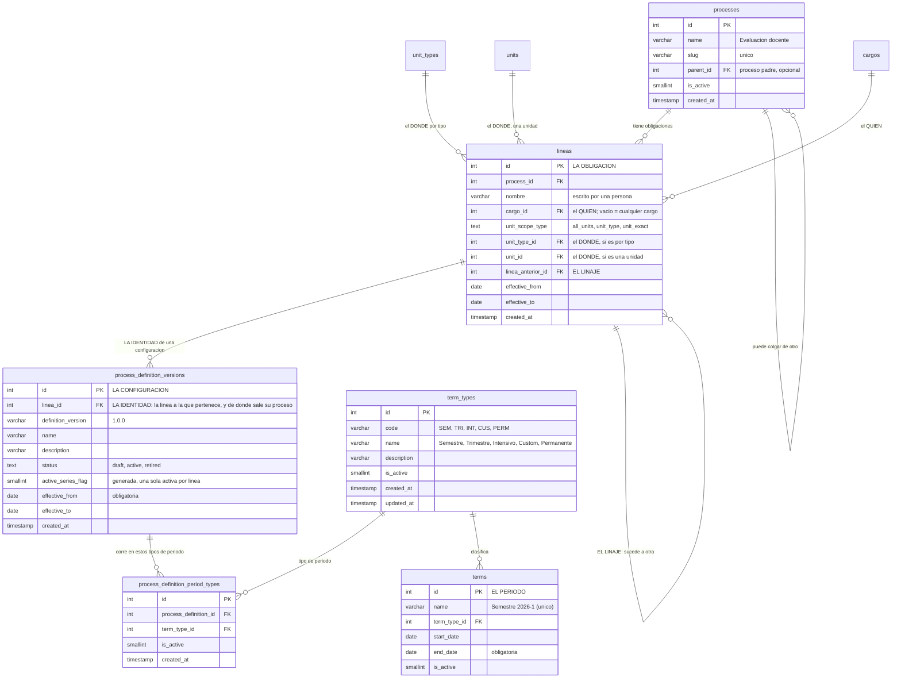

Un **proceso** (`processes`) es apenas un nombre: «Evaluación docente», «Informe semestral». No
contiene reglas. Puede colgar de otro proceso —`parent_id` es autorreferencial—, formando un árbol.

Las reglas viven un piso más abajo, en la **configuración** (`process_definition_versions`). Y aquí
está la primera decisión de diseño importante: **una configuración no se edita, se versiona**. Cuando
cambian las reglas nace una versión nueva y la anterior se retira. La retirada no se borra: se queda
como registro de cómo se hacían las cosas entonces.

Cada configuración tiene tres estados, cerrados por un `CHECK`: `draft` mientras se prepara, `active`
cuando rige, y `retired` cuando la sustituyó otra. **Solo puede haber una activa por línea**, y de
nuevo es la base quien lo garantiza: la columna generada `active_series_flag` más el índice único
`uq_process_definition_one_active_linea` sobre `(linea_id, active_series_flag)` lo hacen imposible.

:::caution[Dónde se impone cada mitad de «no se edita, se versiona»]

Son dos mecanismos distintos, y conviene no confundirlos.

**La base** impone la unicidad de la activa (índice), y **un trigger**
(`trg_process_definition_versions_before_update`) impide pasar a `active` una configuración que no
tenga al menos una regla de alcance activa *y* un tipo de periodo activo — con mensaje de error en
español.

**El servicio** impone la inmutabilidad: `ensureDraftDefinitionContext` rechaza tocar las reglas, los
vínculos a plantilla o los tipos de periodo de una configuración que no esté en `draft`. Eso no está
en el esquema, así que una escritura directa a la base sí podría saltárselo.

:::

## Las tres coordenadas de una configuración

Una configuración no se identifica solo por su proceso. Lleva tres coordenadas más, y cada una
responde a una pregunta distinta:

- **La línea** (`lineas`) — **de quién es la obligación y dónde vive**, los dos ejes juntos. Es la
  identidad de la configuración.
- **La vigencia** (`effective_from`, obligatoria, y `effective_to`, opcional) — desde cuándo rige y
  hasta cuándo.

Junto a ellas va `definition_version`, la etiqueta de versión de las reglas (`1.0.0` en la que siembra
el arranque). **La pareja `(línea, versión)` es única.**

:::note[Aquí había una tercera coordenada, y era una copia]

Hasta el **2026-10-11** había una «variación»: una etiqueta de texto en la configuración, con valor
`general` por defecto, y la identidad era el trío *(proceso, variación, versión)*. Esa etiqueta era
**una copia** del `code` de la serie, arrastrada por un gancho del CRUD que **no era transaccional** —
y los dos índices únicos de la tabla estaban **sobre la copia**, no sobre el dato. Peor: el arranque
usaba dos constantes para una sola cosa, así que en una base recién sembrada **todas** las
configuraciones tenían la etiqueta distinta de su origen.

Hoy la identidad es la **línea**, que es una columna y un `id`. El detalle medido está en el frente
25 del plan.

:::

:::note[La LÍNEA sustituyó a la serie, y por qué]

El **2026-10-11** la tabla **`lineas`** ocupó el sitio de la serie y de la variación. No es un
sinónimo: una línea lleva **los dos ejes a la vez** —`cargo_id` (el quién) y el
alcance (el dónde: `unit_scope_type` con `all_units`, `unit_type` o `unit_exact`)— mientras la serie admite **uno
o el otro**, nunca los dos.

**Y eso era la causa de un problema real.** Los cargos del catálogo son genéricos —`Coordinador`,
`Docente`, `Director`…: no existe «Coordinador de Carrera»—, así que una obligación como *«el Informe
de Investigación Formativa de los Coordinadores de Carrera»* necesita cargo **y** tipo de unidad. Al
no caber en la serie, el otro eje había que ponerlo en la regla de reparto — y se podía elegir cuál
iba dónde. Las dos formas pasan, significan cosas distintas y en pantalla se ven iguales: **la
variación estaba partida en dos tablas**.

La línea trae además dos cosas que hoy no se pueden expresar:

- **Nombre propio.** El de la serie se derivaba con `slugify(cargo.name)`, así que renombrar un cargo
  disparaba dos cascadas.
- **Linaje y vigencia** (`linea_anterior_id`, `effective_from`/`effective_to`), que contestan *«¿cambió
  de manos esta obligación?»*. Hoy no se puede saber: la serie se elige **en cada versión**, así que
  «v1 por Coordinador, v2 por Director» es escribible y produce una historia falsa. Suceder a una
  línea **obliga a haberla retirado antes**, y lo impone la base.

El arranque siembra la del «Proceso por defecto» —`cargo_id` vacío y
`unit_scope_type = 'all_units'`, porque un memo lo escribe quien lo necesita donde lo necesita—, y
con la serie se fueron **seis mecanismos**: el eje único y su `CHECK`, el `code` derivado, las dos
cascadas no transaccionales que se disparaban al renombrar un cargo, el recompositor de nombres y la
copia `variation_key`. El detalle medido está en el frente 25 del plan.

:::

## El tiempo: periodos y tipos de periodo

Los procesos ocurren dentro de un **periodo** (`terms`): «Semestre 2026-1». Cada periodo es de un
**tipo** (`term_types`), y una configuración declara en qué tipos de periodo corre
(`process_definition_period_types`, una fila por tipo).

El esquema siembra cinco tipos de periodo, y no son los que se supondrían:

| Código | Nombre | Para qué |
|---|---|---|
| `SEM` | Semestre | Periodo académico semestral |
| `TRI` | Trimestre | Periodo académico trimestral |
| `INT` | Intensivo | Periodo académico intensivo |
| `CUS` | Custom | Periodo operativo personalizado |
| `PERM` | Permanente | Periodo **centinela** de todos los tiempos |

:::note[Corrección respecto al borrador de este artículo]

El borrador hablaba de tipos «semestral, anual, permanente» y ponía «Año 2026» como ejemplo de
periodo. **No existe un tipo anual**: los cinco son los de la tabla de arriba, sembrados con `id` fijo
por `postgres_schema.sql`. Lo que se puede es crear un `terms` de tipo `CUS` que dure un año.

:::

El tipo **`PERM`** merece mención aparte: sobre él cuelga el periodo «Permanente» que crea el
arranque, y es lo que permite que existan tareas sueltas que no esperan a que empiece un semestre. El
bootstrap **falla en voz alta** si no encuentra ese tipo.

Un detalle del esquema que sorprende al consultarlo: `terms.name` es **único** y `end_date` es
**obligatoria**. No hay periodos sin final; el «Permanente» lo resuelve con una fecha lejana, no con
un `NULL`.

## El diagrama

