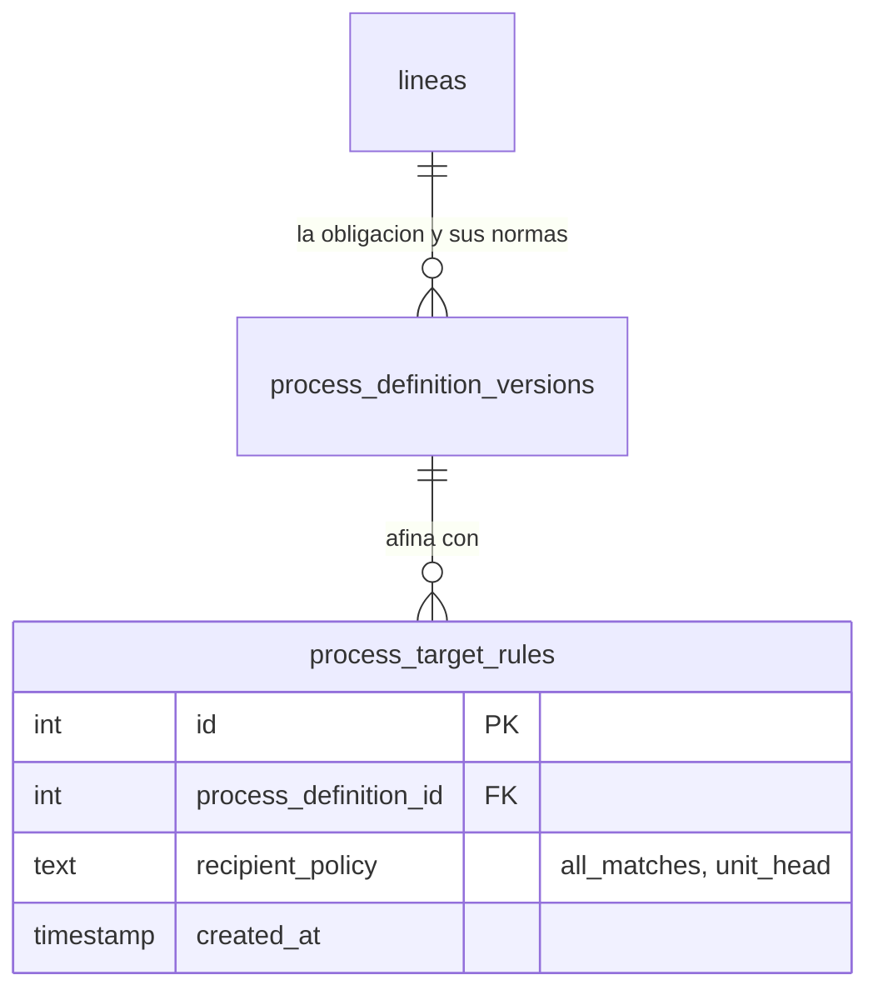

Una configuración por sí sola no sabe a quién dirigirse. Eso lo dicen las **reglas de reparto**
(`process_target_rules`), y son la pieza que convierte «este proceso existe» en «a estas cuarenta
personas les va a tocar».

## Una pregunta, y antes eran dos

Hasta el 2026-10-14 la regla respondía **dos** preguntas: hasta dónde llega y a quién de ahí dentro.
La primera ya la contestaba la [obligación](/modelo/proceso/), así que la regla llevaba una **copia**
de sus dos ejes —el cargo y el ámbito— sostenida por un guardia cuyo único trabajo era comprobar que
coincidía con su origen. Hoy la regla responde una sola pregunta:

| Pregunta | Dónde se contesta |
|---|---|
| **¿Hasta dónde llega?** | la **obligación**: `cargo_id` + `unit_scope_type` |
| **¿A quién de ahí dentro?** | la **regla**: `recipient_policy` |

`recipient_policy` está cerrada por `CHECK`, y cada valor cubre algo que un cargo **no puede
expresar**:

| Valor | Qué dice |
|---|---|
| `all_matches` | sin recorte. Es el defecto y no añade nada |
| `unit_head` | **«el que manda aquí, sea quien sea»** |

### Por qué `unit_head` no es redundante

**`unit_head` no se puede escribir con un cargo**, porque el cargo de la jefatura **varía por tipo de
unidad**: en una Escuela es el Director, en una Carrera el Coordinador, en una Jefatura el Jefe, en el
Prorrectorado el Prorrector. Una obligación que es **una** —*«el responsable de cada unidad entrega su
informe»*— necesitaría cuatro obligaciones distintas para decirse por cargo. Y resuelve sin
ambigüedad porque el modelo garantiza **una jefatura por unidad**.

Así que esto **no es «cómo se reparte»**: es **el quién, cuando el cargo no basta porque varía**.

Un detalle de la resolución que no se ve en la declaración: **`unit_head` no inventa sustituto.** Si
una unidad del alcance no tiene jefatura marcada, esa unidad se queda fuera de la regla. Elegir «el
primero de la lista» es exactamente el fallo que esa decisión vino a cerrar.

:::note[Lo que se fue de la regla, y por qué]

**El 2026-10-14 la regla perdió seis columnas** y bajó de diez a cuatro. No fue una limpieza: fue
quitar una copia, y después quitar lo que nombraba a alguien.

| Columna | Por qué se fue |
|---|---|
| `cargo_id` · `unit_scope_type` · `unit_type_id` · `unit_id` | **copia de la obligación**. La regla nació tres meses antes que ella, cuando la regla *era* la declaración; al subir los dos ejes a su sitio, estas cuatro se quedaron atrás |
| `priority` | **no ordenaba nada.** Las reglas de una configuración se **unen**, y lo que se acumula es el puesto, sin mirar de qué regla vino: cambiar el orden no podía cambiar el resultado |
| `position_id` | con la política `exact_position`, que **nombraba una plaza** |

Lo que lo demostró no fueron los datos, fue el **comportamiento**: había dos consultas del mismo
módulo preguntando lo mismo a dos tablas distintas. Con dos sitios donde mirar, *«a quién alcanza esta
obligación»* tenía dos respuestas posibles — y nada garantizaba que fueran la misma, porque el
guardia blindaba el cargo y el tipo pero la unidad la leía y **no la usaba nunca**.

**Se perdieron dos cosas, y las dos eran redundantes**: una obligación sin acotar cuyo reparto la
estrechaba a una unidad (es una obligación de esa unidad), y una obligación sin cargo cuyo reparto lo
fijaba (es una obligación con cargo). Las dos se declaraban donde no hay nombre, ni vigencia, ni
linaje, y pasan a declararse donde sí los hay. **No se perdió capacidad: se movió a donde queda
escrita.**

:::

:::note[Y por qué se fue `exact_position`]

Nombraba **una plaza**, y tres cosas lo condenaban:

1. **Se saltaba la obligación.** Con el puesto puesto, la resolución consultaba ese puesto **sin cargo
   y sin ámbito**, y nada comprobaba que cayera dentro de la obligación. Es el mismo agujero que se
   había cerrado para `unit_id`, abierto por la única columna que había quedado.
2. **No hacía falta para lo que parecía.** *«La asistente de la Escuela X»* es una obligación
   *(cargo: Asistente, unidad exacta)*: en el catálogo real ese cargo tiene **una plaza por unidad**.
   El único cargo con varias plazas en la misma unidad es el de Docente — y el número de plaza es un
   número, no una función: «la plaza 3» no dice qué se debe.
3. **Era nombrar a alguien dentro de una norma.** Eso ya tiene camino y no es una obligación del
   puesto: la **tarea ad-hoc**, que admite persona concreta y se revoca sin versionar nada. Es la
   misma razón por la que los resolutores de flujo perdieron «elegir a mano».

:::

Una configuración puede tener **varias** reglas y sus resultados se **suman**, pero con dos valores
eso ya no distingue nada: `unit_head` está contenido en `all_matches`, así que dos reglas en la misma
configuración o son la misma o una absorbe a la otra.

:::note[La vigencia está en dos niveles, y el reparto no es uno de ellos]

Hasta el 2026-10-12 la regla llevaba `is_active` y dos fechas propias, de modo que el reparto podía
entrar y salir sin que la configuración cambiara. Se retiraron las tres porque no es así como
cambia el reparto en una institución: *«desde marzo también las Tecnologías»* no es encender una
regla, es que **cambió la norma** — y una reforma se aprueba entera.

Así que la vigencia vive donde hay un acto que la respalde:

| | Qué lleva |
|---|---|
| **La obligación** ([`lineas`](/modelo/proceso/)) | vigencia (`effective_from` / `effective_to`) y **ningún interruptor**: una obligación no se apaga, se **deroga**, con fecha y casi siempre a futuro |
| **La norma** (`process_definition_versions`) | **estado** (¿aprobada?) **y** vigencia: aprobar y entrar en vigor son dos actos distintos |
| **El reparto** (`process_target_rules`) | nada. Nace y muere con su versión de la norma |

Dos disparadores sostienen la jerarquía: la ventana de una norma **cabe dentro** de la de su
obligación, y una obligación no puede recortarse por debajo de las normas que ya cuelgan de ella.

:::

## El resultado de una regla son sillas, no personas

Una regla se resuelve a una lista de **puestos** (`unit_positions` activos, en unidades activas).
Quién esté sentado en cada uno se mira en ese momento, y se mira con un `LEFT JOIN` contra
`position_assignments`: **un puesto vacío sigue siendo un destino válido**.

Conviene ser exacto sobre qué pasa en cada caso, porque el borrador de este artículo lo resumía de una
forma que hoy no se sostiene:

| Situación | Qué ocurre al lanzar |
|---|---|
| Ninguna regla alcanza ningún puesto | El lanzamiento termina con `no_assignees` y **no crea ni tarea ni entregable** |
| La regla alcanza un puesto **ocupado** | Se crea el entregable con `responsible_position_id` y `assigned_person_id` |
| La regla alcanza un puesto **vacío** | Se crea igual, anclado al puesto, con `assigned_person_id` en `NULL` — y su primer turno en `task_item_tenures` nace **sin persona**, que es como se representa el abandono |

:::note[Lo que sí desapareció: el entregable sin puesto]

Hasta el 2026-08-23 existía un camino de respaldo (`ensureTaskItemsForTask`) que, cuando la regla no
encontraba a nadie, creaba el entregable **sin puesto responsable**: nacía sin nadie que respondiera de
él, no aparecía en la lista de nadie, y ahí se quedaba — mientras la misma respuesta del lanzamiento ya
declaraba `has_assignees: false`. Ese respaldo se retiró, y con él `responsible_position_id` pasó a ser
`NOT NULL`. El aviso sigue saliendo, y es el que hay que atender: lo que falta es una regla de alcance
o un puesto ocupado, no un entregable huérfano.

:::

Un último recorte que conviene tener presente: en el disparo automático **solo las plantillas
vinculadas en modo `single` generan entregable**. Las de modo `replicated` y `routed` esperan a que una
persona las instancie.

## El diagrama

