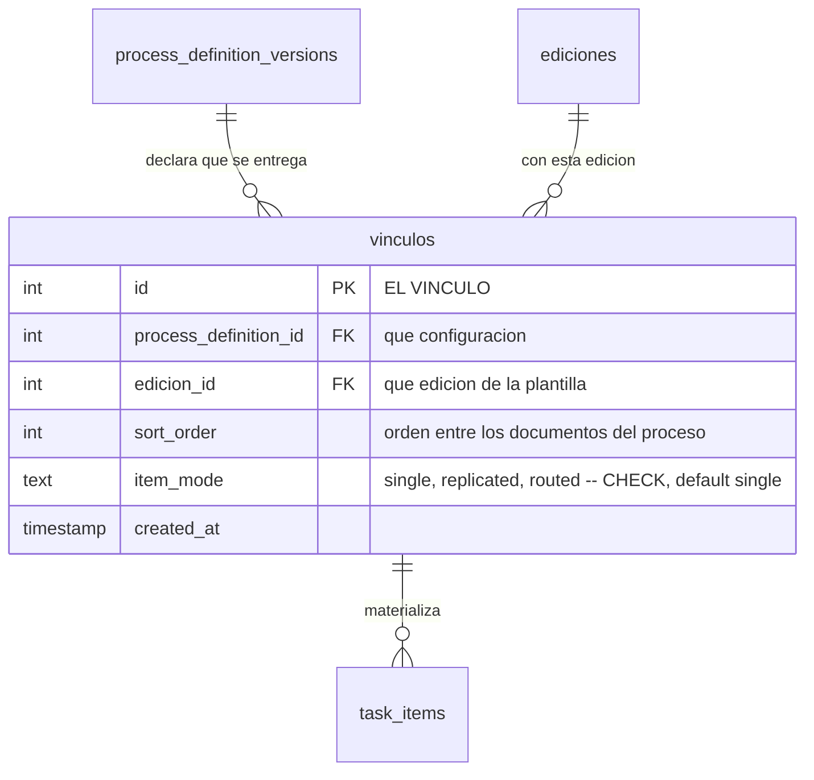

El **vínculo** (`vinculos`) es la frase que cierra la mitad declarativa: *«en
esta configuración del proceso, se entrega este documento, usando esta edición de la plantilla, de
esta manera»*.

Es una tabla pequeña y hace mucho. Además de unir configuración (`process_definition_id`) con
edición (`edicion_id`), guarda el **orden** en que aparecen los documentos de un proceso
(`sort_order`) y, sobre todo, el **modo** (`item_mode`).

## Los tres modos, que no son variantes técnicas sino tres formas de trabajar

`item_mode` tiene un `CHECK` con tres valores, y por defecto vale `single`.

| Modo | Flujo | Cuántos entregables | Cuándo se decide quién entrega y quién firma |
|---|---|---|---|
| `single` | predefinido en la plantilla | uno por puesto alcanzado, al disparar | en la autoría de la plantilla |
| `replicated` | predefinido en la plantilla | los que cree el responsable, con su etiqueta | en la autoría de la plantilla |
| `routed` | **no hay** | los que se creen a mano | **al instanciar**, en runtime |

- **Único** (`single`) — el documento y su recorrido están decididos de antemano. Al dispararse el
  proceso aparece *un* entregable por puesto alcanzado, ya con su recorrido de entrega y de firma
  puestos. Es el caso del informe que todos los coordinadores deben entregar igual. **Es el único
  modo que el lanzamiento materializa solo**: `ensureTaskItemsForTaskTargets()` filtra
  explícitamente por `item_mode === 'single'`.
- **Replicado** (`replicated`) — el recorrido está decidido, pero la cantidad no. El responsable
  crea tantas copias como necesite, cada una con su etiqueta (`task_items.title`), y todas heredan
  el mismo recorrido. Es el caso de «un acta por cada reunión que hayas tenido».
- **Abierto** (`routed`) — no hay recorrido predefinido. Quien lo usa **define en el momento** quién
  entrega y quién firma. Es el modo del «Proceso por defecto», y es lo que permite «hazme el informe
  de este evento y que lo firme el decano» sin que nadie haya configurado nada antes.

:::note[El modo es del vínculo, no de la plantilla]

`item_mode` es una columna de la tabla que **une**, no de `ediciones`. Su único índice
único es `uq_vinculos (process_definition_id, edicion_id)`: la misma
edición puede vincularse a varias configuraciones, y **cada vínculo lleva su propio modo**.

O sea que una misma plantilla puede usarse de forma rígida en un proceso y de forma abierta en otro
sin necesidad de duplicarla. Es una propiedad del modelo que conviene no perder.

:::

:::caution[Pero no a otro PROCESO: eso lo impide un disparador]

Lo de arriba es cierto **dentro de un proceso**: la misma edición puede estar vinculada a varias
configuraciones, de la misma línea o de varias líneas de ese proceso, y cada vínculo lleva su modo.

Lo que **no** puede es cruzar de proceso. Lo impone la base, con el disparador
`trg_vinculo_formato_un_proceso`: al vincular una edición, **todas** las configuraciones ya
vinculadas a cualquier edición de ese mismo formato tienen que pertenecer al mismo proceso. El
primer vínculo de un formato siempre pasa — no hay con qué comparar. Si se cruza, el `INSERT` muere
con un mensaje escrito para una persona, y la API lo devuelve como 400: *«El entregable "X" ya se usa
en otro proceso y no se puede vincular aquí.»*

**Y hasta el 2026-10-12 esta regla era más estricta: decía «una sola LÍNEA».** Se retiró por decisión
del dueño, y el motivo es de forma, no de comodidad: **rompía la simetría del modelo**.

El modelo declara **dos identidades al mismo nivel**, cada una con sus versiones, y un puente que une
**versión con versión**:

```
   formato   1 ──── N   ediciones            el papel y sus versiones
   línea     1 ──── N   configuraciones      la obligación y su historia
                vinculos: edición ↔ configuración
```

La regla vieja no hablaba de eso: imponía algo **entre las dos identidades**, y en un solo sentido.
La prueba de que era la pieza asimétrica es que **su enunciado espejo es absurdo**:

| Lo que imponía | Su reflejo |
|---|---|
| «un **formato** pertenece a **una** línea» | «una **línea** pertenece a **un** formato» |
| estaba impuesto | **es falso**: una obligación produce varios entregables — el informe y su anexo |

Una regla cierta en un sentido y absurda en el otro **subordina una identidad a la otra**.

**El caso que lo destapó:** el mismo Informe de Investigación Formativa lo entregan las
Coordinaciones de **Carrera** y las de **Tecnología**, que son dos tipos de unidad y por tanto dos
líneas. Con la regla vieja había que **duplicar el formato** — justo la avería que este modelo viene
quitando —, o meter los dos ámbitos en una sola línea, y entonces no se podría retirar uno sin el
otro, porque la vigencia y el linaje son de la línea entera.

**La simetría ya no depende de que alguien se acuerde**: tres pruebas de
`backend/database/postgres_schema.test.js` comprueban que el formato no declare ninguna columna que
apunte a la obligación, que la obligación no declare ninguna que apunte al papel, y que el puente
siga uniendo versiones y no identidades.

:::

:::caution[Y nunca a un formato PERSONAL: eso lo impiden otros dos disparadores]

Desde el **2026-10-11** un vínculo sólo admite un entregable **oficial**. Si su
`catalogo_documental.template_scope` es `ad_hoc`, el `INSERT` muere:
*«El formato "X" es personal y no puede estar detrás de una obligación institucional. Un vínculo
sólo admite formatos oficiales.»*

**La regla en una frase:** la institución obliga con su formato, y una persona encarga con el formato
de la institución **o con el suyo** — pero un formato privado nunca está detrás de una obligación
institucional. Si lo estuviera, la institución obligaría a cientos de personas a entregar un
documento cuyo papel es de alguien, que puede cambiarlo, versionarlo o perder el acceso.

**Son dos disparadores y hacen falta los dos**, porque con uno solo la prohibición se rodea en dos
pasos: crear el formato como oficial, vincularlo, y después cambiarlo a personal — una escritura que
no toca esta tabla. Así que `trg_formato_vinculado_sigue_oficial` cierra el otro lado: un formato ya
vinculado **no puede volverse personal** sin desvincularlo primero. Uno sin vínculos sí puede.

**No lo cubre el disparador de arriba**, y no es un olvido suyo: ése compara el **proceso**, no de
quién es el formato. Son dos garantías independientes sobre la misma tabla. Hasta esa fecha la combinación
era **alcanzable y no la validaba nadie** —ni un `CHECK`, ni un disparador, ni un guardia de
JavaScript—, lo que se comprobó provocándola.

**Por qué disparadores y no un `CHECK`.** La regla cruza dos tablas: el vínculo apunta a una
**edición** y la propiedad vive en su **catálogo**, y un `CHECK` sólo ve su propia fila. Copiar
`template_scope` a `ediciones` para exigirlo con una clave ajena compuesta sería la misma duplicación
que se acaba de quitar dos veces.

:::

## Dos consecuencias del modo que no se ven en la tabla

**Publicar exige flujo, salvo en `routed`.** Al publicar una edición se comprueba que tenga al menos
un paso de entrega en su recorrido; la comprobación se omite si la edición está vinculada **solo** en modo
`routed`, porque en ese modo el flujo no se autora, se define al enviar.

**El modo viaja con el clon, y hubo que arreglarlo.** Versionar una configuración copia sus
vínculos, y `item_mode` es `NOT NULL DEFAULT 'single'`: dejarla fuera de la copia no daba error,
convertía en `single` —en silencio— todo vínculo `routed` o `replicated`. Como clonar es lo que hace
la actualización guiada de plantillas, cada actualización deshacía el modo. Le pasó al «Proceso por
defecto» en la base de dev, cuyo vínculo original decía `routed` y el de la configuración activa
decía `single`. Hoy `cloneProcessDefinitionChildren()`
(`backend/services/admin/processes/processDefinitionVersion.js`) selecciona e inserta `item_mode`
explícitamente. Si añades una columna de datos a esta tabla, añádela también ahí.

## Qué cuelga del vínculo aguas abajo

El vínculo no desaparece al dispararse el proceso: cada entregable concreto guarda de qué vínculo
nació (`task_items.vinculo_id`), y esa referencia forma parte de su identidad.
El detalle está en [El entregable concreto](/modelo/entregable-concreto/).


